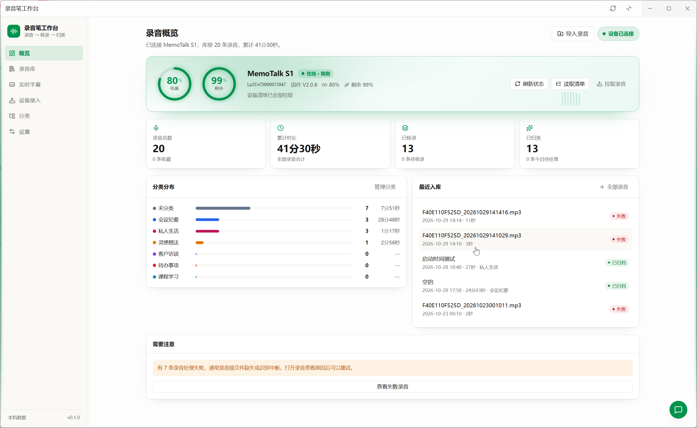

English | [简体中文](README.zh-CN.md)

# OpenMinutes

> Turn MemoTalk S1 voice-recorder MP3s into searchable, categorized text you can review.

`OpenMinutes` (formerly `memotalk-workbench`) is a complete open-source [Floatboat](https://floatboat.ai) Workbench app, used with the [`memotalk-sdk`](https://github.com/floatboatai/memotalk-sdk) hardware client.

---

## Preview

### MemoTalk S1


### OpenMinutes Workbench



## Why OpenMinutes?

Recordings accumulate every day, but finding a particular conversation or listening back to everything becomes difficult.

This workbench connects sync, transcription, classification, and search in one workflow. Each recording has a clear stage label: on recorder, awaiting transcription, transcription queued, transcribing, awaiting classification, classification queued, classifying, organized, or failed. Batch operations use the selected recordings, or every recording in the current stage.

## Features

The left navigation has six fixed items. Every feature has exactly one entry point, and each page title matches its navigation label (the UI is in Chinese; English names are given here):

| Navigation | What the page owns |
| --- | --- |
| Recordings (录音, default) | Stats bar (click "failed N" to filter failures), full-text search over transcripts, titles, and summaries, stage/category/tag filters and sorting, batch or "transcribe all / organize all (N)", and the **Import** dialog that scans a local folder. A recording's detail page offers HTTP Range playback, sentence-timestamp seeking, transcript / AI analysis / processing-history sections, manual edits, export, and deletion; its header has a single primary action that follows the recording's state |
| Recorder (录音笔) | Connect / disconnect, battery and free space, sync (with progress and **Stop**), the "still on the recorder" list with per-item sync, cleanup of already-synced recordings to free recorder space, and auto-connect status. The recorder clock is synced on connect |
| Live captions (实时字幕) | Stream recorder audio through Floatboat speech recognition, then save the recording and any text when stopped |
| Today (今日) | Two bots work over a whole day of recordings: Shell-picker (拾贝) splits it into scenes and matches a template; Bead-stringer (串珠) extracts people, concepts, methods, decisions, todos and ideas per template. Runs automatically after transcription; can be re-run manually |
| Calendar (日历) | Day view of events and recordings, linking recordings to events (the only place to do so), new events, `.ics` import, and meeting digests |
| Categories (分类) | Create, rename inline, recolor, and delete custom categories (built-in ones cannot be deleted); each shows its recording count and total duration |
| Settings (设置) | General (folders) / Automation / Recognition / Diagnostics & advanced. Diagnostics & advanced is the single place for technical detail: environment checks and "let the Floatboat assistant repair", Python/ffmpeg paths, transport, recent recorder operations, Host capabilities, the device protocol reference, and developer tools |

Transcription decodes audio to 16 kHz mono PCM16 with `ffmpeg` and streams it through Host ASR, storing the full text and timestamped segments. AI classification uses the Host LLM to produce structured titles, summaries, categories, tags, key points, action items, and importance.

Errors show a one-sentence Chinese conclusion and a next step. Technical detail (exception type, exit code, Host error code) appears only after clicking "view details", and the full log lives in Settings › Diagnostics & advanced.

### Recorder transport

- For a user-initiated sync, a batch totalling at least 1 MiB (or containing recordings of unknown size) uses the recorder's **wireless fast transfer** (Wi-Fi hotspot + FTP) by default; smaller batches use Bluetooth. A note under the button warns that the computer will be briefly offline.
- During wireless fast transfer the computer joins the recorder's hotspot and loses internet access. Running transcription/classification tasks finish first (up to 3 minutes; otherwise the batch uses Bluetooth), new AI tasks queue, and other online operations such as calendar digests return "try again later". Afterwards the computer reconnects to its original network and the recorder's hotspot is turned off.
- If wireless fast transfer fails at any stage, sync continues over Bluetooth. The UI shows a single "switched to Bluetooth" notice; the reason is under "view details".
- Sync does not start while the recorder is recording. A download is attached to the library only if its size matches what the recorder reported.
- Background auto-sync never switches networks by default: it uses Bluetooth for recordings under 1 MiB (at most 3 per round) and leaves larger ones for a manual sync. Enable `auto_pull_wifi` under Settings › Automation to allow wireless fast transfer in the background.
- A fixed transport (auto / always wireless / always Bluetooth) is set under Settings › Diagnostics & advanced.
- A user-initiated connection disconnects after 10 idle minutes to save recorder battery; auto-connect sessions disconnect as soon as their work is done. After a manual **Disconnect**, auto-connect stays paused until you click **Connect** again.
- Platform requirements: Windows needs a wireless adapter (uses the built-in `netsh`); macOS needs Wi-Fi; Linux needs NetworkManager (`nmcli`). macOS and Linux support is experimental and falls back to Bluetooth on failure.

## Getting started

The app runs in the **Floatboat desktop Workbench runtime**. It is a workbench package loaded by the Host, not a standalone Node service.

- The Host prepares dependencies, runs strict TypeScript checks, compiles the server, and bundles the UI. Generated files go in `dist/` and are not committed.
- The Host applies SQLite migrations when opening the workbench. Add new files to `migrations/`; do not rewrite existing migrations.
- ASR and LLM calls use Host capabilities. This repository neither contains nor requires model API keys.

```bash
pnpm install          # Install UI dependencies, type definitions, and test tooling
```

Then use Floatboat's `check_workbench_project` to run type checks and build the app, and `workbench_runtime open` to apply the update. These are Host operations, not package scripts.

### Runtime dependencies

| Dependency | Purpose | Behavior when missing |
| --- | --- | --- |
| `ffmpeg` | Audio probing and decoding | Transcription is unavailable, and the UI reports it |
| `python` + `bleak` + `memotalk-sdk` | Connect to the recorder, sync recordings, and live captions | The recorder page says the recorder component is not ready and links to diagnostics; local folder import remains available |

Tool discovery tries configured paths, Floatboat's bundled tools, `PATH`, and command names in that order, so it does not rely solely on the process `PATH`.

Check Settings › Diagnostics & advanced › Environment for the Python interpreter in use, then install the device SDK into that same environment:

```bash
uv pip install --python "/path/to/python" "memotalk-sdk>=0.1.0"
"/path/to/python" -m memotalk.cli --version
```

On Windows, use the absolute path to `python.exe`. In PowerShell, prefix the quoted interpreter path with `&` when running the version check. If you use a virtual environment, select its Python interpreter in settings.
The SDK installs `bleak` automatically; you do not need to clone its source or configure an SDK directory.
The app uses `from memotalk import MemoTalkClient` for device APIs and live audio streaming.
Upgrading removes the old `sdk_dir` setting while preserving other path, recognition, and automation settings.

For hardware specifications and firmware questions, join the Floatboat official community group (see [Community](#community)).

### Device SDK regression tests

`pnpm test` runs the server tests. Device SDK integration tests drive the device worker (connect, listing, Bluetooth and wireless transfer, cancellation, network restore) with the package's simulated device. They do not connect to a physical recorder or call the real `netsh` / `nmcli` / `networksetup`.
Set the `MEMOTALK_TEST_PYTHON` environment variable to the path of a Python interpreter with `memotalk-sdk` installed before running them.
Without this variable, these tests are skipped; settings API and migration tests still run.

### CI

GitHub Actions runs `pnpm test:ci` on pull requests and pushes to `main`, using
Ubuntu and Windows with Node 22 and 24. It installs a persistent Python 3.12
environment with `memotalk-sdk==0.1.0`, plus uv, ffmpeg and ffprobe. The CI command
fails if these prerequisites are missing, then runs both the application tests
and the verification helper regressions (`pnpm test:verification`).
Windows also runs the WinRT import and offline TTS tests; those platform-specific
tests are skipped on Linux.

Floatboat compiler builds, browser acceptance, physical BLE devices and paid
ASR/LLM calls are not part of this workflow. They remain separate local
verification steps under `.claude/skills/verify-openminutes`.

## Project structure

```text
src/
  contracts/       Shared DTOs (app.ts, device.ts, calendar.ts, preflight.ts), error model (errors.ts), input validation (input.ts), busy states (recording-status.ts)
  server/          Node server: assembly, routing, and domain logic
    index.ts       Server assembly: device service, auto-connect scheduler, route registration
    routes/        HTTP routes grouped by domain
    app-route.ts   App metadata, statistics, and tag-list routes
    http.ts        Shared API envelope; AppError / system errors -> Chinese error + code + detail
    sql.ts         Thin node:sqlite wrapper, settings, and job records
    repo.ts        Queries, transient queued-status projection, and library-wide hasActiveTasks
    library.ts     Library root, monthly folders, and legacy audio-path resolution
    ingest.ts      Directory scanning, manifest registration, download attachment, deduplication, naming conflicts
    device/        Sole owner of the device SDK (memotalk-sdk)
      service.ts     Connection state machine, single mutex, idle disconnect, live-caption handoff, diagnostics log
      sync.ts        Sync orchestration (list -> register -> transfer -> size check -> attach) and cleanup
      transport.ts   Transport planning (wireless fast transfer / Bluetooth) and wireless-adapter probing
      worker.ts      Spawns the resident Python worker and speaks JSON-lines RPC
      worker-script.ts Worker Python source: connect, list, sync, delete, network join and restore
      errors.ts      Device SDK exceptions -> Chinese error codes
      auto-connect.ts Auto-connect scheduler (disconnects when done; paused after manual disconnect)
      fake-device.ts Fake recorder (tests only; loaded when OPENMINUTES_FAKE_DEVICE is set)
    network-gate.ts Network gate during wireless transfer: pauses AI tasks, fails off-queue calls fast
    media.ts       ffmpeg probing, duration parsing, and PCM16 framing
    transcribe.ts  Host ASR sessions: parameter fallback, streaming, resumption, error classification
    organize.ts    Host LLM structured classification and text fallback
    pipeline.ts    Transcription/classification state machines and retries
    jobs.ts        Task scheduling and automatic transcription after import/sync
    queue.ts       Serial task execution, pending/running labels, and task-state queries
    calendar*.ts   Calendar events, .ics import, recording links, and meeting digests
    preflight.ts   Environment checks and the Host capability list
    environment-repair.ts, repair-store.ts Floatboat-assistant environment repair
    runtime-probe.ts, tools.ts, paths.ts Python / bleak / device SDK / ffmpeg discovery and paths
    live.ts        Live-caption sessions, file storage, and saving (capture process spawned by the device service)
    live-audio.ts  Live MP3 decoder arguments and one-second PCM framing
    live-asr.ts    On-demand live ASR sessions and frame streaming
    live-script.ts Python script for device SDK live audio streaming
  ui/              React UI: recordings / today / details / recorder / live captions / calendar / categories / settings (incl. diagnostics)
migrations/        Append-only SQLite migrations (0001-0007)
sdk/               Host SDK: Host-provided Workbench runtime, clients, contracts, and types (not modified)
tests/             Server tests
manifest.json      Host entry points, build profile, capabilities, and audio resource
index.html         UI build entry point
```

Related documentation (in Chinese): [requirements](REQUIREMENTS.md), [engineering conventions](ENGINEERING.md), and [design](DESIGN.md).

## Data model

`devices`, `recordings`, `transcripts`, `analyses`, `categories`, `tags`, `recording_tags`, `job_runs`, `sdk_commands`, `settings`, `calendar_events`, and `environment_repairs`.

Transcription/classification failures are stored in three columns: `recordings.last_error` (Chinese conclusion), `last_error_code`, and `last_error_detail` (technical text). `devices.ble_address` remembers the last connected recorder so the next connection prefers it; no serial number needs to be entered.

### Storage and directories

- `import_dir` is the scan source and the default audio export destination, defaulting to `~/memo/memotalk/inbox`. Scans create a missing directory, read only its immediate files, and copy supported audio (`.mp3`, `.wav`, `.m4a`, `.aac`, `.ogg`, `.flac`, `.amr`, `.opus`) into the library without removing the originals.
- `library_dir` defaults to `~/memo/memotalk/raw`. Imports and recorder syncs are copied into `<library_dir>/<yyyy-MM>/`, using the recording month inferred from the filename or a fallback date. Live recordings also go into monthly folders. Use an absolute path or `~/...` for these directory settings; changing the library setting does not relocate existing files.
- New `recordings.storage_path` values store the full destination path (absolute with the default or an absolute library directory). Historical relative filenames resolve against the Host's `audio` data resource. Recorder syncs first stage files in the Host's `audio/_incoming/<job id>/` (one directory per sync, removed afterwards), not `import_dir`.
- Deletion attempts to move audio to `<library_dir>/_trash/<milliseconds>-<basename>` using the **current** library setting, then deletes the recording and its transcript, analysis, tag links, and job history. If the move fails, database deletion still proceeds; `audioMovedToTrash` is then `null`. There is no restore API.
- Export copies the audio under its original `filename` into `import_dir`, or into the request body's optional `directory`. It creates missing destination directories and can overwrite a same-named file. The detail page uses the default destination. There is no separate export-directory setting.

When resolving `import_dir`, an empty value falls back to the default; a path inside the system temporary directory is replaced with the default and written back to settings. An explicit `directory` in a scan request is used and saved directly, without that temporary-directory fallback.

## Settings

The settings page has four sections, and every path is edited only here:

| Section | Contents |
| --- | --- |
| General | `library_dir`, `import_dir` |
| Automation | `auto_transcribe`, `auto_analyze`, `auto_connect`, `auto_connect_minutes`, `auto_pull` (sync new recordings after connecting), `auto_pull_wifi` (allow wireless fast transfer for large recordings in background sync) |
| Recognition | `speaker_diarization`, `asr_hotwords`, `asr_language` |
| Diagnostics & advanced (`#/settings/diagnostics`, collapsed by default) | Environment, `python_path` / `ffmpeg_path`, `device_transport`, recent recorder operations, Host capabilities, device protocol reference, developer tools (manual manifest registration), copy diagnostics report |

`PATCH /api/settings` accepts `{ "values": { "key": "value" } }`; all values must be strings.

| Keys | Behavior and defaults |
| --- | --- |
| `library_dir`, `import_dir` | Empty by default; resolved as described above; at most 500 characters each |
| `python_path`, `ffmpeg_path` | Empty by default for automatic discovery; at most 500 characters each |
| `auto_transcribe`, `auto_analyze` | Automatically transcribe after import/sync and classify after transcription; both default to `"1"` |
| `auto_connect`, `auto_pull` | Auto-connect to the recorder on an interval; sync new recordings once connected (a manual **Connect** also starts a sync right away); both default to `"1"` |
| `auto_pull_wifi` | Whether background sync may use wireless fast transfer (briefly offline), default `"0"` |
| `device_transport` | `auto` (default) / `wifi` / `ble`; fixes the transport |
| `auto_connect_minutes` | Integer string from `"1"` to `"120"`, default `"3"` |
| `speaker_diarization` | File-transcription speaker separation, default `"1"` |
| `asr_hotwords` | File-transcription hotwords, empty by default; at most 300 characters |
| `asr_language` | At most 20 characters; the UI offers automatic (empty), `zh`, `en`, and `ja`. Currently saved as file-transcription metadata, but not passed to ASR |

Flags accept only `"0"` or `"1"`. Auto-connect runs while the workbench server is open and disconnects when done. Live ASR currently uses fixed PCM parameters rather than the file-transcription hotword, language, or speaker settings. `GET /api/settings` can also return runtime-written `device_serial`, `device_user_disconnected`, `last_auto_connect_at`, and `last_auto_pull_at`; these are not writable through PATCH (`device_user_disconnected` is set only by **Disconnect** and cleared by **Connect**). The removed `sdk_dir` is hidden on reads and ignored on writes; other unknown keys are rejected.

## API overview

| Method | Path | Description |
| --- | --- | --- |
| `GET` | `/api/app` | Application name and version |
| `GET` | `/api/overview` | Recording statistics (total, duration, awaiting transcription, failed, on-recorder `pendingCount`) and per-category counts/durations `byCategory` |
| `GET` | `/api/tags` | Tag names for filtering |
| `GET` | `/api/recordings` | List recordings with search, stage/category/tag/favorite/archive filters, sorting, and pagination; data contains `items`, `total`, and library-wide `hasActiveTasks` |
| `GET` | `/api/recordings/:id` | Details: metadata, transcript, AI analysis, and processing history |
| `GET` | `/api/recordings/:id/tags` | Tag IDs and names for one recording |
| `PATCH` | `/api/recordings/:id` | Edit title, summary, category, tags, importance, favorite, and archive flags; `calendarEventId` (positive integer or `null`) is the only write path for recording-event links |
| `DELETE` | `/api/recordings/:id` | Delete a recording; attempt to move audio to `<library_dir>/_trash/<milliseconds>-<basename>` |
| `GET` | `/api/recordings/:id/audio` | Audio stream with HTTP Range support (206 and `content-range`; 416 for out-of-range requests) |
| `POST` | `/api/recordings/:id/export` | Copy audio to `import_dir` by default; optional body field `directory` overrides it |
| `POST` | `/api/recordings/:id/transcribe` | Queue transcription; after prerequisite checks, reject already queued/running recordings with `BUSY` |
| `POST` | `/api/recordings/:id/organize` | Queue AI classification; after prerequisite checks, reject already queued/running recordings with `BUSY` |
| `POST` | `/api/recordings/batch/transcribe`, `/api/recordings/batch/organize` | Queue transcription or classification for body field `ids`, or pass `{ stage: "ready" }` / `{ stage: "transcribed" }` to let the server select every recording in that stage (up to 400). Skip already queued/running or otherwise ineligible recordings |
| `GET` | `/api/ingest/directory` | Read import directory information |
| `POST` | `/api/ingest/scan` | Scan the import directory (created if missing) |
| `POST` | `/api/ingest/manifest` | Manually register recorder manifest entries (diagnostics developer tool only) |
| `GET` | `/api/device` | Recorder view: connection state, battery and space, sync progress, last result, recordings still on the recorder, cleanable count, auto-connect status. Reads memory and caches only; never spawns probes |
| `POST` | `/api/device/connect` | Connect and sync the recorder clock; starts a sync right away when `auto_pull` is on. Returns the recorder view |
| `POST` | `/api/device/disconnect` | Disconnect and pause auto-connect until the next manual connect |
| `POST` | `/api/device/sync` | Sync all new recordings (list, register, transfer); returns `{ jobId }` immediately |
| `POST` | `/api/device/pull` | Sync specific recordings, body `{ ids }` (1-100); returns `{ jobId }` |
| `POST` | `/api/device/cancel` | Stop the running sync (cooperative; wireless transfer restores the network first) |
| `POST` | `/api/device/cleanup` | Delete already-synced, size-verified recordings from the recorder; returns `{ jobId }` |
| `GET` | `/api/diagnostics` | Diagnostics data: environment, recent recorder operations, transport setting and measured speeds, device protocol reference, Host capabilities |
| `GET` | `/api/environment` | Environment check report and repair task state |
| `POST` | `/api/environment/check` | Re-run the environment check |
| `POST` | `/api/environment/repair` | Ask the Floatboat assistant to repair the environment |
| `GET` | `/api/environment/capabilities` | Host ASR/LLM operation availability |
| `GET` | `/api/live` | Live caption status |
| `POST` | `/api/live/start`, `/api/live/stop` | Start or stop live captions; returns `DEVICE_BUSY` while the recorder is syncing |
| `GET`, `POST` | `/api/calendar/events` | List events in a time range, or create an event |
| `GET` | `/api/calendar/events/:id` | One event |
| `GET` | `/api/calendar/events/:id/recordings`, `/api/calendar/recordings` | Recordings linked to an event, or recordings in a time range |
| `GET`, `POST` | `/api/calendar/events/:id/digest` | Read or generate an event's meeting digest |
| `POST` | `/api/calendar/digest` | Generate a daily digest |
| `POST` | `/api/calendar/import` | Import an `.ics` file |
| `GET` | `/api/recordings/:id/calendar-suggestions` | Suggest events to link based on the recording time |
| `GET` | `/api/scenes?day=YYYY-MM-DD` | Scenes of one local day: timeline, matched template, per-template extraction, status and staleness |
| `POST` | `/api/scenes/rebuild` | Queue re-segmentation and extraction for `{ day }`; rejected when the day has no transcripts |
| `GET` | `/api/templates` | Active scene templates (built-in: social, lecture, meeting, musing, ambient) |
| `GET`, `POST` | `/api/categories` | List or create categories |
| `PATCH`, `DELETE` | `/api/categories/:id` | Update or delete a category |
| `GET`, `PATCH` | `/api/settings` | Read settings or update the writable keys listed above |

JSON responses use the `{ ok: true, data }` / `{ ok: false, error, code, detail?, action? }` envelope: `error` is a one-sentence Chinese conclusion, `detail` holds the technical text (shown only under "view details"), and `action` is an optional link to the next step. Node system errors are mapped by errno to Chinese messages (no permission, disk full, file moved). The audio endpoint returns an audio stream on success. Online operations return `NETWORK_PAUSED` during wireless fast transfer.

### Queued tasks and polling

- `queued_transcribe` ("transcription queued") and `queued_organize` ("classification queued") are temporary statuses projected by the server from its in-memory queue into recording summaries and details, not stored in SQLite. Stored `transcribing` / `analyzing` statuses take precedence. Stage filters still use stored statuses. Code: `src/server/queue.ts:25`, `src/server/repo.ts:30`, `src/server/repo.ts:59`, `src/server/repo.ts:202`.
- `GET /api/recordings` returns `data.hasActiveTasks`: whether any transcription/classification task is queued or running across the library. It checks queue labels and stored running statuses, independently of search, filters, and pagination. Code: `src/server/repo.ts:150`, `src/contracts/app.ts:115`.
- Single-recording transcription/classification checks audio/text prerequisites first, then returns `BUSY` for an already queued or running recording. Batch operations skip such recordings and report `accepted`, `skipped`, and accepted `ids`. Code: `src/server/routes/pipeline.ts:25`, `src/server/routes/pipeline.ts:46`, `src/server/routes/pipeline.ts:66`, `src/server/routes/pipeline.ts:84`.
- The detail page polls every 2.6 seconds while its recording is queued or running and stops when that recording leaves those states. The library polls at the same interval while `hasActiveTasks` is true, even if active recordings are outside the current results; it stops when no queued or running tasks remain across the library. Code: `src/contracts/recording-status.ts:1`, `src/ui/pages/Detail.tsx:51`, `src/ui/pages/Library.tsx:54`, `src/ui/useApi.ts:48`.
- `queue.ts` retains waiting and running task labels until `finally` removes them, including after failure, and exposes task-state queries. `repo.ts` combines these queries with stored statuses to build response statuses and `hasActiveTasks`. Code: `src/server/queue.ts:8`, `src/server/queue.ts:25`, `src/server/queue.ts:31`, `src/server/repo.ts:59`, `src/server/repo.ts:150`.

## Design principles

- One entry point per feature. Connect, disconnect, sync, and cleanup live only on the Recorder page; import only in the Recordings header; recording-event links only on the Calendar page; paths only in Settings. Other pages only link there.
- Two-layer errors. The main UI shows a Chinese conclusion and a next step; technical detail appears only under "view details", with the full log in Settings › Diagnostics & advanced.
- Background work never changes the network. Wireless fast transfer runs only for manual syncs, or in the background when `auto_pull_wifi` is enabled.
- Report failures honestly. If the recorder component is not ready, audio cannot play, or upstream ASR fails, the UI reports the problem and offers a next action.
- Communicate status with both text and color, never color alone. Animations respect `prefers-reduced-motion`.
- Prioritize lists. Each recording occupies one row, content is at most 1220 px wide, and table numbers use `tabular-nums` for alignment.
- Support accessibility. Icon-only buttons have `aria-label` and `title`; segmented controls use `aria-pressed`.

See [DESIGN.md](DESIGN.md) for more design decisions.

## Related repositories

- [`floatboatai/memotalk-sdk`](https://github.com/floatboatai/memotalk-sdk): Python client (Bluetooth, Wi-Fi hotspot, and FTP) and CLI for the MemoTalk S1

## Community

Hardware details for MemoTalk S1 are shared in the Floatboat official WeChat community group — scan the QR code in [README.zh-CN.md](README.zh-CN.md#加入-floatboat-官方交流群).

## License

[MIT](LICENSE) © Floatboat and MemoTalk
