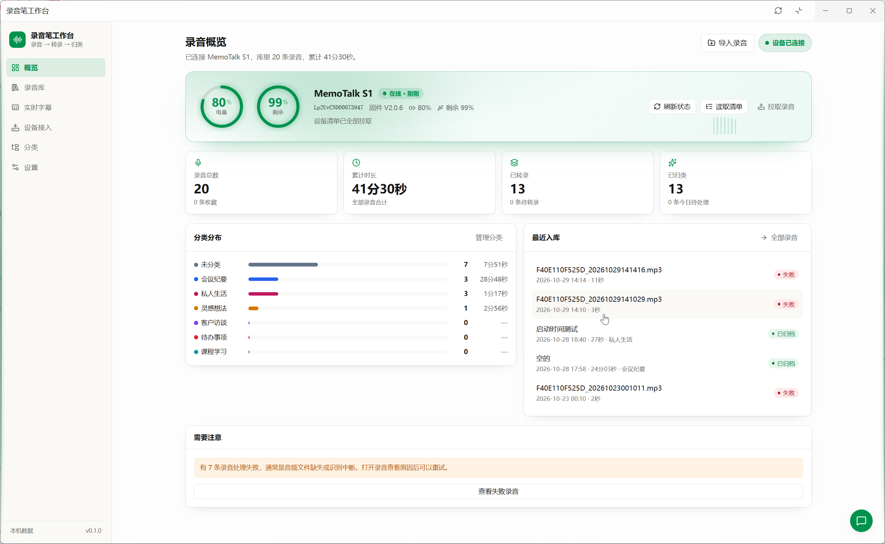

[English](README.md) | 简体中文

# OpenMinutes

> 把 MemoTalk S1 录音笔里堆着的 MP3，变成可搜索、可分类、可复盘的文本资产。

`OpenMinutes`（原名 `memotalk-workbench`）是 [Floatboat](https://floatboat.ai) 工作台应用的一份完整开源实现，配套硬件客户端 [`memotalk-sdk`](https://github.com/floatboatai/memotalk-sdk) 使用。

---

## 产品与工作台预览

### MemoTalk S1 录音笔


### OpenMinutes 工作台



## 它解决什么问题

录音笔的典型困境：素材每天在增长，但你听不回去、也找不回来。

这个工作台把「同步 → 转录 → 归类 → 检索」做成一条闭环流水线，每条录音在列表上都有明确阶段标签（在录音笔中 / 待转录 / 转录已排队 / 转录中 / 待归类 / 归类已排队 / 归类中 / 已整理 / 失败），批量操作按勾选的录音或当前阶段的全部录音执行。

## 功能

左侧导航固定 6 项，每个功能只有一个入口，页面标题与导航名称一致：

| 导航 | 拥有的功能 |
| --- | --- |
| 录音（默认页） | 统计条（点「失败 N」直接筛出失败录音）、全文搜索（正文 + 标题 + 摘要）、阶段/分类/标签筛选与排序、勾选批量或「全部转录（N）/ 全部归类（N）」、页头「导入」对话框扫描本地文件夹。点开一条进入详情：HTTP Range 播放、按句时标跳转、转录全文 / AI 结论 / 处理记录分区、人工修正、导出与删除；页头只有一个随状态切换的主按钮 |
| 录音笔 | 连接 / 断开连接、电量与剩余空间、同步录音（带进度与「停止」）、「还在录音笔里」列表与单条同步、清理已同步的录音（释放录音笔空间）、自动连接状态。连接时自动校时 |
| 实时字幕 | 录音笔音频流经 Floatboat 语音识别实时出字，停止后保存录音及已有文本 |
| 今日 | 拾贝把一天的录音切成场景并匹配模板，串珠按模板整理人物、概念、方法、决策、待办与灵感；转录完成后自动整理，可手动重新整理 |
| 日历 | 按日查看事件与录音、录音与日程的关联（唯一入口）、新建事件、导入 `.ics`、生成会议纪要 |
| 分类 | 新增、就地改名、改色、删除自定义分类（内置分类不能删除），每个分类显示条数与总时长 |
| 设置 | 通用（目录）/ 自动化 / 识别 / 诊断与高级。「诊断与高级」是唯一的技术细节区：本机环境自检与「让 Floatboat 助手修复」、Python/ffmpeg 路径、传输方式、最近设备操作、宿主能力、设备协议指令参考与开发者工具 |

转录用 `ffmpeg` 解码为 16 kHz 单声道 PCM16，经 Host ASR 流式识别，落库全文与分段时间轴；AI 归类由 Host LLM 结构化输出标题、摘要、分类、标签、要点、待办和重要度。

出错时主界面只显示一句中文结论和下一步；技术原文（异常类型、退出码、宿主错误码等）要点「查看详情」才展开，也可以在「设置 › 诊断与高级」里查看完整记录。

### 录音笔传输

- 用户手动同步时，本批待同步总量 ≥ 1 MiB（或含大小未知的录音）就默认走录音笔的**无线快传**（Wi-Fi 热点 + FTP），否则走蓝牙。按钮下方会提示「期间电脑会暂时断开外网」。
- 无线快传期间电脑临时连上录音笔热点、断开外网：进行中的转录/归类先完成（最多等 3 分钟，超时本批改走蓝牙），新的 AI 任务自动排队，日历纪要等需要联网的操作暂时返回「请稍后再试」；完成后自动连回原网络，并关闭录音笔热点。
- 无线快传在任何阶段失败都会自动改用蓝牙继续，界面只提示一行「已改用蓝牙」，原因在「查看详情」里。
- 录音笔正在录音时不会开始同步。下载结果与录音笔上报的大小一致才入库。
- 后台自动同步默认不切网：只用蓝牙同步小于 1 MiB 的录音（每轮最多 3 条），大录音留给手动同步；可在「设置 › 自动化」开启「后台自动同步大录音时也用无线快传」。
- 固定传输方式（自动 / 始终无线快传 / 始终蓝牙）在「设置 › 诊断与高级」中设置。
- 用户手动连接的会话空闲 10 分钟自动断开以节省录音笔电量；自动连接建立的会话用完即断。手动「断开连接」后自动连接暂停，直到再次点「连接」。
- 平台要求：Windows 需要无线网卡（使用系统自带的 `netsh`）；macOS 需要 Wi-Fi；Linux 需要 NetworkManager（`nmcli`）。macOS 与 Linux 为实验性支持，失败时自动回退蓝牙。

## 快速上手

本应用运行在 **Floatboat 桌面端的工作台运行时**中。它不是独立的 Node 服务，而是一个由 Host 装载的工作台包。

- Host 负责依赖准备、strict TypeScript 检查、server 编译与 UI 打包（产物落在 `dist/`，不入库）。
- SQLite 迁移由 Host 在打开工作台时应用（`migrations/` 只追加，不回改）。
- ASR 与 LLM 通过 Host 能力调用，本仓库不包含、也不需要任何模型密钥。

```bash
pnpm install          # 安装 UI 依赖、类型定义和测试工具
```

之后由 Floatboat 执行 `check_workbench_project` 完成类型检查与构建，`workbench_runtime open` 应用更新。这些是 Host 操作，不是 package scripts。

### 运行时依赖

| 依赖 | 用途 | 缺失时行为 |
| --- | --- | --- |
| `ffmpeg` | 音频探测与解码 | 转录不可用，页面如实提示 |
| `python` + `bleak` + `memotalk-sdk` | 连接录音笔、同步录音与实时字幕 | 录音笔页提示「录音笔组件还没准备好」并链接到诊断区，本地文件夹导入仍可用 |

工具路径按「设置值 → Floatboat 内置工具 → `PATH` → 命令名」逐级探测，不仅依赖进程 `PATH`。

在「设置 › 诊断与高级 › 本机环境」查看实际使用的 Python 解释器，将设备 SDK 安装到同一个环境：

```bash
uv pip install --python "/path/to/python" "memotalk-sdk>=0.1.0"
"/path/to/python" -m memotalk.cli --version
```

Windows 可使用解释器的 `python.exe` 绝对路径。在 PowerShell 中执行版本检查时，需在带引号的解释器路径前加上 `&`。若使用虚拟环境，在设置中选择该环境的 Python。
SDK 会自动安装 `bleak`；无需克隆 SDK 源码或配置 SDK 目录。
应用通过 `from memotalk import MemoTalkClient` 调用设备 API 和实时音频流。
升级时会清理旧的 `sdk_dir` 配置，其余路径、识别与自动化设置保留。

硬件参数与固件问题，请加入文末的 Floatboat 官方交流群。

### 设备 SDK 回归验证

`pnpm test` 运行服务端测试。设备 SDK 集成测试用包内模拟设备驱动设备 worker（连接、清单、蓝牙与无线快传、取消、网络恢复），不连接真实录音笔，也不调用真实的 `netsh` / `nmcli` / `networksetup`；
设置环境变量 `MEMOTALK_TEST_PYTHON` 为安装了 `memotalk-sdk` 的解释器路径后运行。
未设置时跳过这些用例，设置接口与迁移测试仍会执行。

### CI

GitHub Actions 在 PR 和推送到 `main` 时运行 `pnpm test:ci`，覆盖 Ubuntu、Windows
以及 Node 22、24。工作流安装持久的 Python 3.12 环境、`memotalk-sdk==0.1.0`、
uv、ffmpeg 和 ffprobe。CI 命令先检查依赖，缺失即失败，再执行应用测试及验证工具
回归测试（`pnpm test:verification`）。Windows 还会运行 WinRT 导入和离线 TTS
测试；Linux 跳过这两项平台专属测试。

Floatboat 编译器构建、浏览器验收、真实 BLE 设备和付费 ASR/LLM 调用不属于这个
工作流，仍通过 `.claude/skills/verify-openminutes` 在本地单独验证。

## 目录结构

```text
src/
  contracts/       跨端 DTO（app.ts、device.ts、calendar.ts、preflight.ts）、错误模型（errors.ts）、输入校验（input.ts）、忙碌状态（recording-status.ts）
  server/          Node 服务端：装配、路由、领域逻辑
    index.ts       服务装配：设备服务、自动连接调度、路由注册
    routes/        按领域拆分的 HTTP 路由
    app-route.ts   应用信息、统计与标签列表路由
    http.ts        统一 API 信封；AppError / 系统错误 → 中文 error + code + detail
    sql.ts         node:sqlite 薄封装、设置读写、任务记录
    repo.ts        读取查询、临时排队状态投影与全库 hasActiveTasks
    library.ts     录音库根目录、月目录与历史音频路径解析
    ingest.ts      目录扫描、清单登记、下载文件挂接、去重与命名冲突处理
    device/        设备 SDK（memotalk-sdk）的唯一所有者
      service.ts     连接状态机、单一互斥、空闲断开、实时字幕占用、诊断记录
      sync.ts        同步编排（清单 → 登记 → 传输 → 大小校验 → 入库）与清理已同步
      transport.ts   传输规划（无线快传 / 蓝牙）与无线网卡探测
      worker.ts      常驻 Python worker 的派生与 JSON-lines RPC
      worker-script.ts worker 的 Python 源码：连接、清单、同步、删除、入网与网络恢复
      errors.ts      设备 SDK 异常 → 中文错误码
      auto-connect.ts 自动连接调度器（用完即断，手动断开后暂停）
      fake-device.ts 假录音笔（仅测试，设置 OPENMINUTES_FAKE_DEVICE 时加载）
    network-gate.ts 无线快传期间的网络闸门：暂停 AI 任务、队列外调用快速失败
    media.ts       ffmpeg 探测、时长解析、PCM16 分帧
    transcribe.ts  Host ASR 会话：参数降级、推流、续传、错误归类
    organize.ts    Host LLM 结构化归类与文本回退
    pipeline.ts    转录/归类状态机与重试
    jobs.ts        任务调度与导入/同步后的自动转录
    queue.ts       串行执行、等待/运行中任务标签与任务状态查询
    calendar*.ts   日历事件、.ics 导入、录音关联与会议纪要
    preflight.ts   本机环境自检与宿主能力清单
    environment-repair.ts, repair-store.ts 让 Floatboat 助手修复本机环境
    runtime-probe.ts, tools.ts, paths.ts Python / bleak / 设备 SDK / ffmpeg 探测与路径
    live.ts        实时字幕会话、文件落盘与保存（采集进程由设备服务派生）
    live-audio.ts  实时 MP3 解码参数与按秒分帧的 PCM 流
    live-asr.ts    按需开启的实时 ASR 会话与推流
    live-script.ts 设备 SDK 实时音频流的 Python 脚本
  ui/              React 界面：录音 / 今日 / 详情 / 录音笔 / 实时字幕 / 日历 / 分类 / 设置（含诊断与高级）
migrations/        只追加的 SQLite 迁移（0001–0007）
sdk/               宿主 SDK：Host 提供的 Workbench 运行时、客户端、契约与类型（不改动）
tests/             服务端测试
manifest.json      Host 入口、构建配置、能力与 audio 资源声明
index.html         UI 构建入口
```

配套文档（中文）：[需求](REQUIREMENTS.md)、[工程约定](ENGINEERING.md)、[设计](DESIGN.md)。

## 数据模型

`devices`、`recordings`、`transcripts`、`analyses`、`categories`、`tags`、`recording_tags`、`job_runs`、`sdk_commands`、`settings`、`calendar_events`、`environment_repairs`。

转录/归类失败分三列存储：`recordings.last_error`（中文结论）、`last_error_code`、`last_error_detail`（技术原文）。`devices.ble_address` 记住上次连接的录音笔，下次连接优先找它，不需要手填序列号。

### 存储与目录

- `import_dir` 是扫描来源，也是默认音频导出目录，默认值为 `~/memo/memotalk/inbox`。扫描会创建缺失的目录，只读取当前层文件，将支持的音频（`.mp3`、`.wav`、`.m4a`、`.aac`、`.ogg`、`.flac`、`.amr`、`.opus`）复制进录音库，保留原文件。
- `library_dir` 默认为 `~/memo/memotalk/raw`。目录导入与录音笔同步均复制到 `<library_dir>/<yyyy-MM>/`，月份按文件名推断的录制时间或兜底时间确定。实时录音也写入月目录。这些目录设置请使用绝对路径或 `~/...`；修改录音库设置不会迁移已有文件。
- 新版 `recordings.storage_path` 保存完整目标路径（默认目录或绝对路径配置下为绝对路径）。历史相对文件名仍从 Host 的 `audio` 数据资源解析。录音笔同步先暂存到 Host 的 `audio/_incoming/<任务 ID>/`（每次同步一个独立目录，完成后删除），不是 `import_dir`。
- 删除时先尝试把音频移动到**当前**录音库设置下的 `<library_dir>/_trash/<毫秒时间戳>-<原存储文件名>`，再删除录音及其转录、分析、标签关联和任务历史。移动失败仍会删除数据库记录，此时 `audioMovedToTrash` 为 `null`。目前没有恢复 API。
- 导出按原始 `filename` 将音频复制到 `import_dir`，也可由请求体的 `directory` 指定目标目录。缺失的目标目录会自动创建，同名文件可能被覆盖。详情页使用默认目标，没有独立的导出目录设置。

解析 `import_dir` 时，空值回落到默认目录；系统临时目录内的路径会被替换为默认目录并写回设置。扫描请求显式传入 `directory` 时则直接使用并保存该路径，不经过临时目录回退。

## 设置

设置页分四个分区，所有路径只在这里编辑：

| 分区 | 内容 |
| --- | --- |
| 通用 | `library_dir`、`import_dir` |
| 自动化 | `auto_transcribe`、`auto_analyze`、`auto_connect`、`auto_connect_minutes`、`auto_pull`（连上录音笔后自动同步新录音）、`auto_pull_wifi`（后台自动同步大录音时也用无线快传） |
| 识别 | `speaker_diarization`、`asr_hotwords`、`asr_language` |
| 诊断与高级（`#/settings/diagnostics`，默认折叠） | 本机环境、`python_path` / `ffmpeg_path`、`device_transport`、最近设备操作、宿主能力、设备协议指令参考、开发者工具（手动登记清单）、复制诊断报告 |

`PATCH /api/settings` 接收 `{ "values": { "key": "value" } }`，所有值必须是字符串。

| 设置键 | 行为与默认值 |
| --- | --- |
| `library_dir`, `import_dir` | 默认空值，按上文规则解析；各最多 500 字符 |
| `python_path`, `ffmpeg_path` | 默认空值，自动探测；各最多 500 字符 |
| `auto_transcribe`, `auto_analyze` | 导入/同步后自动转录、转录后自动归类；均默认 `"1"` |
| `auto_connect`, `auto_pull` | 后台按间隔自动连接录音笔；连上后自动同步新录音（手动点「连接」也会直接开始同步）；均默认 `"1"` |
| `auto_pull_wifi` | 后台自动同步时是否允许无线快传（会暂时断开外网），默认 `"0"` |
| `device_transport` | `auto`（默认）/ `wifi` / `ble`，固定传输方式 |
| `auto_connect_minutes` | `"1"` 到 `"120"` 的整数字符串，默认 `"3"` |
| `speaker_diarization` | 文件转录的说话人分离，默认 `"1"` |
| `asr_hotwords` | 文件转录热词，默认空值，最多 300 字符 |
| `asr_language` | 最多 20 字符；界面提供自动（空值）、`zh`、`en`、`ja`。目前只写入文件转录的结果元数据，未传给 ASR |

开关只接受 `"0"` 或 `"1"`。后台自动连接在工作台服务运行期间执行，用完即断开。实时 ASR 当前使用固定 PCM 参数，不读取文件转录的热词、语言或说话人设置。`GET /api/settings` 还可能返回运行时写入的 `device_serial`、`device_user_disconnected`、`last_auto_connect_at`、`last_auto_pull_at`，这些键不能通过 PATCH 修改（`device_user_disconnected` 只由「断开连接」写入、由「连接」清除）。已移除的 `sdk_dir` 在读取时隐藏、写入时忽略，其他未知键会被拒绝。

## API 速览

| 方法 | 路径 | 说明 |
| --- | --- | --- |
| `GET` | `/api/app` | 应用名称与版本 |
| `GET` | `/api/overview` | 录音统计（总数、时长、待转录、失败、在录音笔中 `pendingCount`）与按分类的条数/时长 `byCategory` |
| `GET` | `/api/tags` | 用于筛选的标签名称列表 |
| `GET` | `/api/recordings` | 列表：搜索 / 阶段 / 分类 / 标签 / 收藏 / 归档筛选 / 排序 / 分页；data 含 `items`、`total` 和全库 `hasActiveTasks` |
| `GET` | `/api/recordings/:id` | 详情（元数据 + 转录 + AI 结论 + 处理记录） |
| `GET` | `/api/recordings/:id/tags` | 单条录音的标签 ID 与名称 |
| `PATCH` | `/api/recordings/:id` | 人工修正标题、摘要、分类、标签、重要度、收藏与归档标记；`calendarEventId`（正整数或 `null`）是录音与日程关联的唯一写接口 |
| `DELETE` | `/api/recordings/:id` | 删除录音，尝试将音频移入 `<library_dir>/_trash/<毫秒时间戳>-<原存储文件名>` |
| `GET` | `/api/recordings/:id/audio` | 音频流，HTTP Range（206 + `content-range`，越界 416） |
| `POST` | `/api/recordings/:id/export` | 默认复制音频到 `import_dir`，可用请求体字段 `directory` 覆盖目标目录 |
| `POST` | `/api/recordings/:id/transcribe` | 排队转录；前置条件校验后，已排队/执行中的录音返回 `BUSY` |
| `POST` | `/api/recordings/:id/organize` | 排队 AI 归类；前置条件校验后，已排队/执行中的录音返回 `BUSY` |
| `POST` | `/api/recordings/batch/transcribe`, `/api/recordings/batch/organize` | 按请求体 `ids` 排队转录或归类；或传 `{ stage: "ready" }` / `{ stage: "transcribed" }` 由服务端选出该阶段的全部录音（上限 400）。跳过已排队/执行中及其他不符合条件的录音 |
| `GET` | `/api/ingest/directory` | 读取导入目录信息 |
| `POST` | `/api/ingest/scan` | 扫描导入目录（目录不存在时自动创建） |
| `POST` | `/api/ingest/manifest` | 手动登记录音笔清单条目（只供诊断区开发者工具使用） |
| `GET` | `/api/device` | 录音笔视图：连接状态、电量与空间、同步进度、上次结果、还在录音笔里的录音、可清理数量、自动连接状态。只读内存与缓存，不派生探测进程 |
| `POST` | `/api/device/connect` | 连接录音笔并自动校时；`auto_pull` 开启时随即开始同步。返回录音笔视图 |
| `POST` | `/api/device/disconnect` | 断开连接并暂停自动连接，直到再次连接 |
| `POST` | `/api/device/sync` | 同步全部新录音（读清单、登记、传输），立即返回 `{ jobId }` |
| `POST` | `/api/device/pull` | 同步指定录音，请求体 `{ ids }`（1–100 个），返回 `{ jobId }` |
| `POST` | `/api/device/cancel` | 停止进行中的同步（协作式取消，无线快传会先恢复网络） |
| `POST` | `/api/device/cleanup` | 从录音笔删除已同步且大小一致的录音，返回 `{ jobId }` |
| `GET` | `/api/diagnostics` | 诊断区数据：本机环境、最近设备操作、传输方式与实测速度、设备协议指令参考、宿主能力 |
| `GET` | `/api/environment` | 本机环境自检结果与修复任务状态 |
| `POST` | `/api/environment/check` | 重新检测本机环境 |
| `POST` | `/api/environment/repair` | 让 Floatboat 助手修复本机环境 |
| `GET` | `/api/environment/capabilities` | 宿主 ASR/LLM 操作的可用性 |
| `GET` | `/api/live` | 实时字幕状态 |
| `POST` | `/api/live/start`, `/api/live/stop` | 开始或停止实时字幕；录音笔同步中返回 `DEVICE_BUSY` |
| `GET`, `POST` | `/api/calendar/events` | 按时间范围列出事件，或新建事件 |
| `GET` | `/api/calendar/events/:id` | 单个事件 |
| `GET` | `/api/calendar/events/:id/recordings`, `/api/calendar/recordings` | 某事件关联的录音，或时间范围内的录音 |
| `GET`, `POST` | `/api/calendar/events/:id/digest` | 读取或生成单个事件的会议纪要 |
| `POST` | `/api/calendar/digest` | 生成某一天的日报 |
| `POST` | `/api/calendar/import` | 导入 `.ics` 文件 |
| `GET` | `/api/recordings/:id/calendar-suggestions` | 按录音时间推荐可关联的事件 |
| `GET` | `/api/scenes?day=YYYY-MM-DD` | 某个本地自然日的场景：时间线、匹配的模板、按模板抽取的结果、处理状态与是否过期 |
| `POST` | `/api/scenes/rebuild` | 为 `{ day }` 排队重新切场景并抽取；当天没有转录时拒绝 |
| `GET` | `/api/templates` | 当前生效的场景模板（内置：社交、听课、会议、灵感随记、背景） |
| `GET`, `POST` | `/api/categories` | 列出或新增分类 |
| `PATCH`, `DELETE` | `/api/categories/:id` | 修改或删除分类 |
| `GET`, `PATCH` | `/api/settings` | 读取设置，或修改上文列出的可写设置键 |

JSON 响应统一为 `{ ok: true, data }` / `{ ok: false, error, code, detail?, action? }` 信封：`error` 是一句中文结论，`detail` 是技术原文（只在「查看详情」中显示），`action` 是可选的跳转建议。Node 系统错误按 errno 映射为中文（例如没有权限、磁盘空间不足、文件已被移走）。音频接口成功时返回音频流。无线快传期间需要联网的操作返回 `NETWORK_PAUSED`。

### 排队任务与轮询

- `queued_transcribe`（转录已排队）和 `queued_organize`（归类已排队）是服务端根据内存队列临时投影到录音摘要及详情中的状态，不写入 SQLite。数据库中的 `transcribing` / `analyzing` 优先展示；阶段筛选仍按数据库状态执行。代码依据：`src/server/queue.ts:25`、`src/server/repo.ts:30`、`src/server/repo.ts:59`、`src/server/repo.ts:202`。
- `GET /api/recordings` 返回 `data.hasActiveTasks`，表示全库是否有排队或进行中的转录/归类任务。它同时检查队列标签和数据库中的执行中状态，不受搜索、筛选或分页影响。代码依据：`src/server/repo.ts:150`、`src/contracts/app.ts:115`。
- 单条转录/归类先校验音频或文本前置条件，再对已排队或执行中的录音返回 `BUSY`。批量操作跳过这些录音，并返回 `accepted`、`skipped` 及接受的 `ids`。代码依据：`src/server/routes/pipeline.ts:25`、`src/server/routes/pipeline.ts:46`、`src/server/routes/pipeline.ts:66`、`src/server/routes/pipeline.ts:84`。
- 详情页在当前录音排队或执行中时每 2.6 秒轮询，离开这些状态后停止。录音库在 `hasActiveTasks` 为 true 时以相同间隔轮询，即使活跃录音不在当前结果中；全库没有排队或执行中任务后才停止。代码依据：`src/contracts/recording-status.ts:1`、`src/ui/pages/Detail.tsx:51`、`src/ui/pages/Library.tsx:54`、`src/ui/useApi.ts:48`。
- `queue.ts` 保留等待和运行中的任务标签，直到 `finally` 清理（包括失败），并提供任务状态查询；`repo.ts` 将查询结果与数据库状态组合，生成响应状态及 `hasActiveTasks`。代码依据：`src/server/queue.ts:8`、`src/server/queue.ts:25`、`src/server/queue.ts:31`、`src/server/repo.ts:59`、`src/server/repo.ts:150`。

## 设计原则（节选）

- **一个功能一个入口**：连接、断开、同步、清理只在「录音笔」页；导入只在「录音」页头；录音与日程的关联只在「日历」页；路径只在「设置」。其他页面只放跳转链接。
- **错误分两层**：主界面只给一句中文结论和下一步，技术原文点「查看详情」才出现，完整记录在「设置 › 诊断与高级」。
- **后台不切网**：后台任务不改变本机网络；只有用户手动同步，或显式开启 `auto_pull_wifi`，才会走无线快传。
- **不伪造成功**：录音笔组件未就绪、音频无法播放、ASR 上游失败，页面一律如实报告，并把失败态变成可继续的动作。
- **状态双编码**：一律「文字 + 颜色」，不只靠颜色区分；动画尊重 `prefers-reduced-motion`。
- **列表优先**：一条录音一行，正文最大宽度 1220 px，表格数字使用 `tabular-nums` 保持纵向对齐。
- **可访问**：仅图标按钮均带 `aria-label` 与 `title`，分段控件用 `aria-pressed`。

更多取舍见 [DESIGN.md](DESIGN.md)。

## 相关仓库

- [`floatboatai/memotalk-sdk`](https://github.com/floatboatai/memotalk-sdk)：MemoTalk S1 的 Python 客户端（蓝牙、Wi-Fi 热点与 FTP）与命令行工具

## 加入 Floatboat 官方交流群

微信扫码（手机上可长按识别二维码）加入 Floatboat 官方交流群，获取 MemoTalk S1 录音笔的硬件详细信息、固件说明与使用支持。群满 200 人会自动创建新群，二维码长期有效；加群遇到问题可在 Floatboat 公众号后台留言。


## 许可证

[MIT](LICENSE) © Floatboat and MemoTalk
