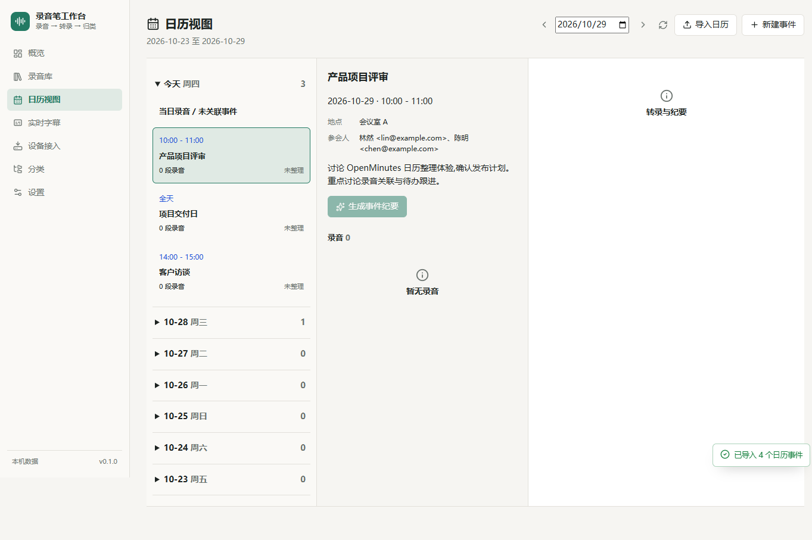
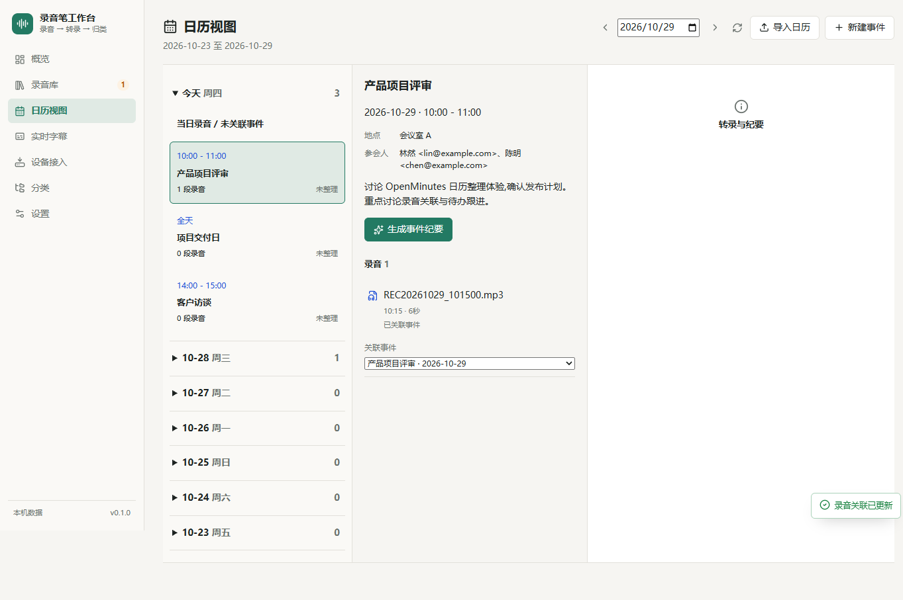
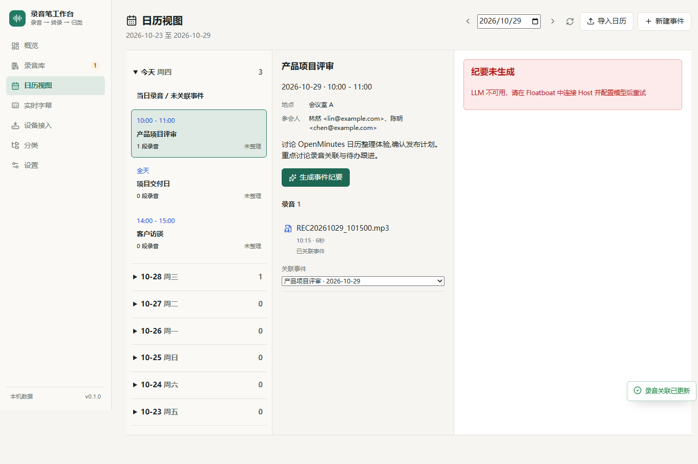
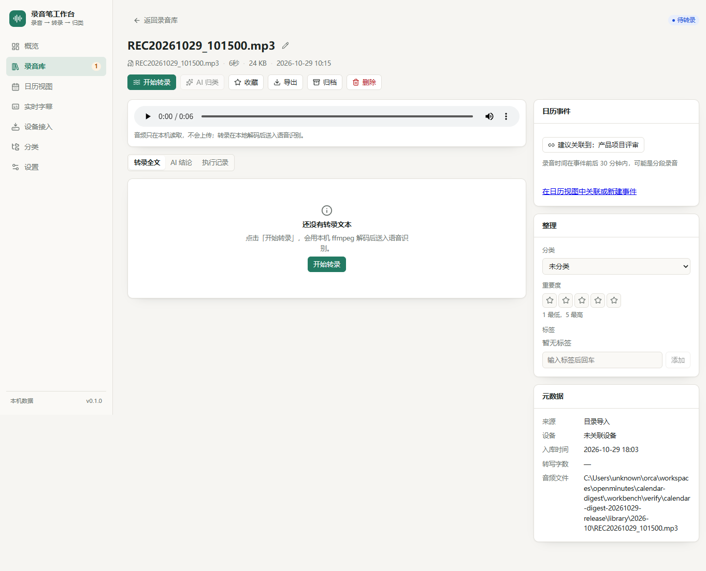
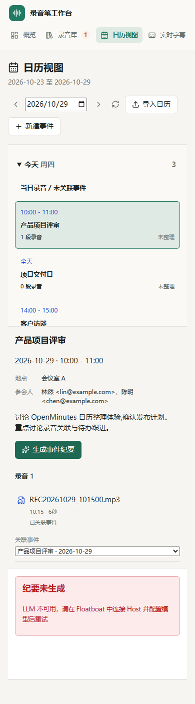

# 日历整理验收记录

## 核心场景

用户带着录音笔完成一天的会议、访谈和随手记录，回到电脑后按日历事件整理录音，
确认需要跟进的事项。一个事件可以关联多段录音；没有事件的录音保留在当日录音中，
标记为未关联，不会被自动归档。

## 本次实现

- `#/calendar`：最近七天的可折叠时间轴、事件信息、录音列表、转录与纪要面板。
- `.ics` 文件选择与导入、UID 去重和更新、手动创建事件。
- 带时区事件转换为 UTC；全天事件独立保存日历日期，不参与自动建议。
- 录音详情与日历列表展示时间匹配建议；时长接近的候选优先。用户确认后才关联。
- 下拉选择器可以关联、换关联或解除关联，不依赖拖拽。
- 事件纪要与每日总结调用 Host LLM；长转录分段汇总，不直接截掉尾部。
- 纪要包含事件信息、讨论要点、决策、TODO、问题、下一步行动及跨录音主题。
- 事件纪要持久化，支持复制和 Markdown 下载。源内容变化会使已保存纪要失效，
  生成期间源内容改变时拒绝保存过期结果。同一事件拒绝并发生成。

## 测试结果

2026-10-29，Windows，Node 26.7.0，pnpm 10.28.2：

- `pnpm test`：38 项，29 通过，0 失败，9 跳过。
- 9 项跳过来自原有 BLE / memotalk-sdk 环境测试，未配置设备专用 Python 环境。
- 新增 12 项测试全部通过，覆盖真实 ICS 样例、时区、全天、折行、参会人、去重、
  非法输入和事务、匹配边界、HTTP 关联读回、prompt、长文本、并发、失效、日报、
  mock Host 响应和独立运行的 Host 不可用错误。
- Floatboat 编译器：`typecheck=passed`、`compilation=passed`。
  唯一 warning 是原有 `src/ui/pages/Device.tsx` 的 `WORKBENCH_LARGE_MODULE`。

验证 skill 来自 `origin/redreamality/pstack`，固定提交
`334d4ec83448506fc5db0416f9cd0d47322452cd`，通过 `git archive` 解压到工作区外。
本分支未复制、未修改 `.claude/skills/verify-openminutes`。

主流程使用 skill 的 build、launch、doctor、browse，在隔离数据目录中验证：

1. 文件输入框导入仓库中的 `test-fixtures/sample-calendar.ics`，四个事件出现并由 API 读回。
2. ffmpeg 生成六秒 MP3，经过设备页“立即扫描”导入，验证归档音频副本存在。
3. 录音详情显示“建议关联到：产品项目评审”，点击关联和解除关联均成功。
4. 日历页通过选择器关联，事件计数变为一段录音，API 读回相同外键。
5. 点击录音展示“尚无转录文本”。点击“生成事件纪要”显示“LLM 不可用”，
   GET 事件确认 digest 仍为 null，没有伪造纪要。
6. 主流程的浏览器控制台无错误或警告，结束时 doctor 验证隔离设置未改变。

补充 Playwright 验证覆盖 1440、1024、390 像素，以及 390 像素深色模式：
检查页面横向溢出、控件文字溢出和页面异常；通过真实表单创建事件并读回地点。
记录既有 `/favicon.ico` 404，未把它误报为本次功能错误。

## 截图

日历主界面：



事件详情与录音关联：



生成纪要结果面板，独立实例无 Host：



录音建议关联：



窄屏：



## 复现

先按外部 skill 的说明 build、launch 隔离实例。不要连接 BLE 或使用正式数据目录。
以下 PowerShell 命令中的 skill 路径指向工作区外的远端快照：

```powershell
$env:OPENMINUTES_ROOT = (Get-Location).Path
$env:OPENMINUTES_VERIFY_SKILL = 'C:/path/to/external-skill/scripts'
node "$env:OPENMINUTES_VERIFY_SKILL/build.mjs"
node "$env:OPENMINUTES_VERIFY_SKILL/launch.mjs" calendar-review
node scripts/verify-calendar.mjs calendar-review
node scripts/verify-calendar-layout.mjs calendar-review
node "$env:OPENMINUTES_VERIFY_SKILL/cleanup.mjs" calendar-review
```

截图、ARIA、动作日志和读回 JSON 位于 `.workbench/verify-evidence/<runId>/`。
Playwright 使用本机 Chrome，不需要下载浏览器。

## 边界与未验证项

- 真实 Host LLM 成功生成、模型质量、实际剪贴板复制与下载成功路径未在独立实例验证。
  生成、落库、prompt 和长文本成功路径由 mock Host 测试覆盖。
- 未使用真实设备、真实 ASR 或真实用户音频；截图中的 MP3 是合成测试音频。
- 第一版明确拒绝 RRULE、RDATE 和 RECURRENCE-ID 重复事件，整份文件不写入，
  提示用户导出单次事件。取消事件跳过；不支持通过导入取消已有事件。
- 没有 CalDAV / Google Calendar API；没有拖拽，使用可键盘操作的选择器。
- 日报按需生成并可导出，不单独持久化。事件纪要持久化在 `calendar_events.digest`。
- SQLite 迁移是增量迁移，不删除已有录音；不提供自动回滚迁移。升级前应备份数据库。
